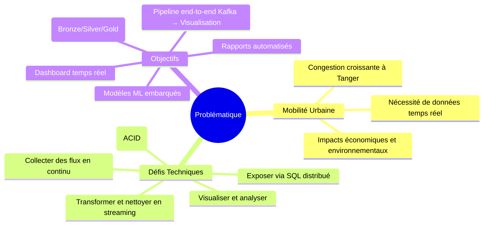
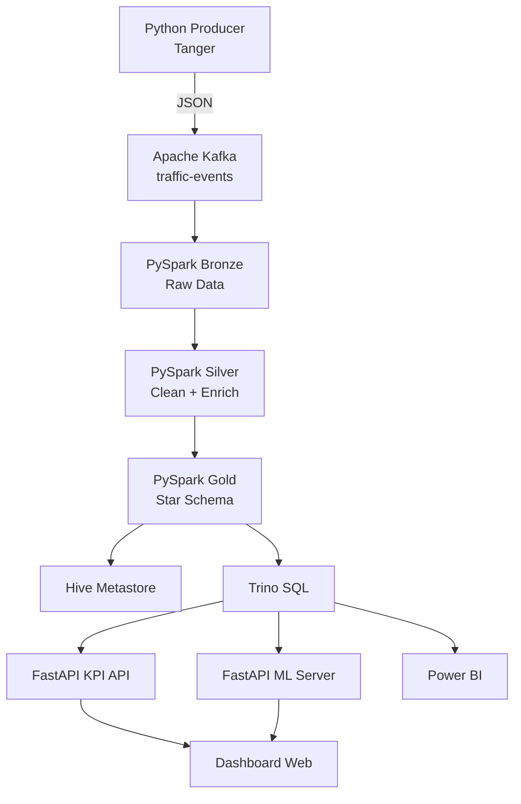
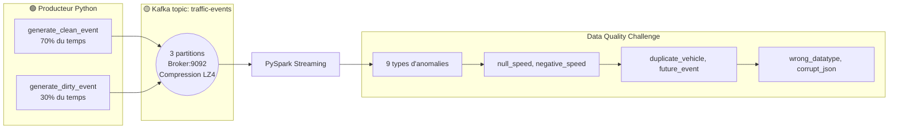
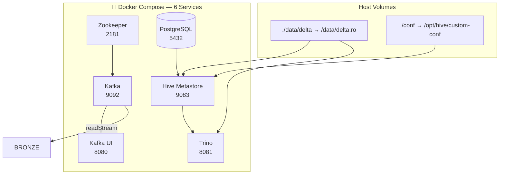
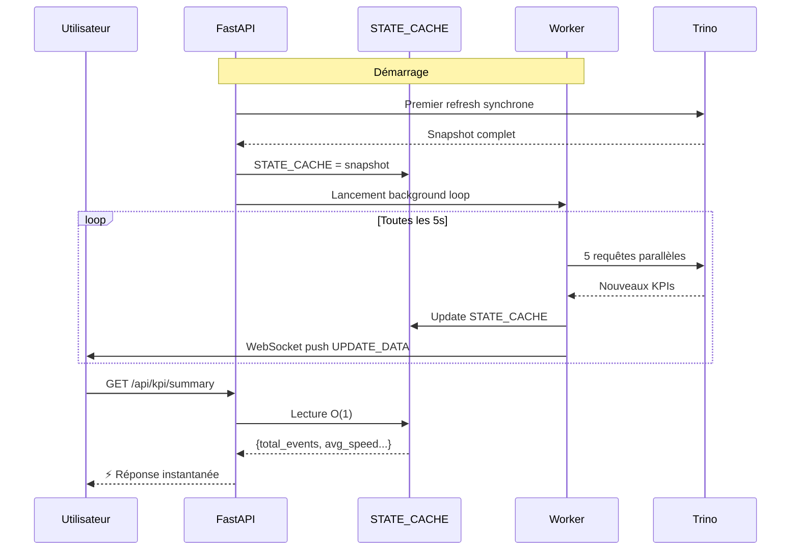
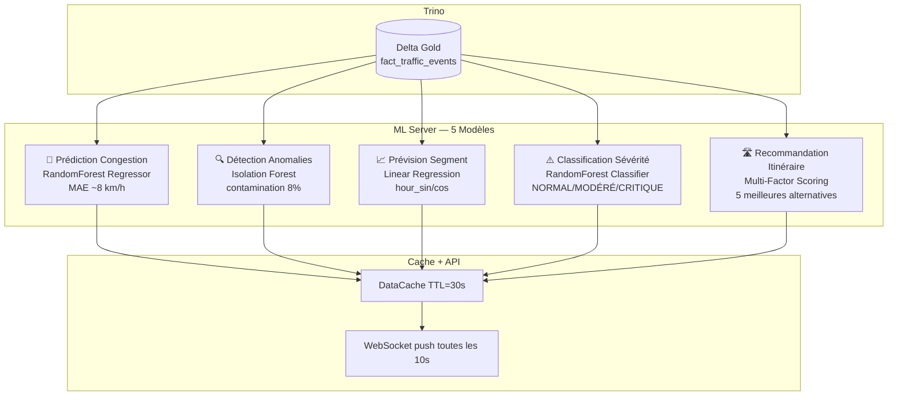
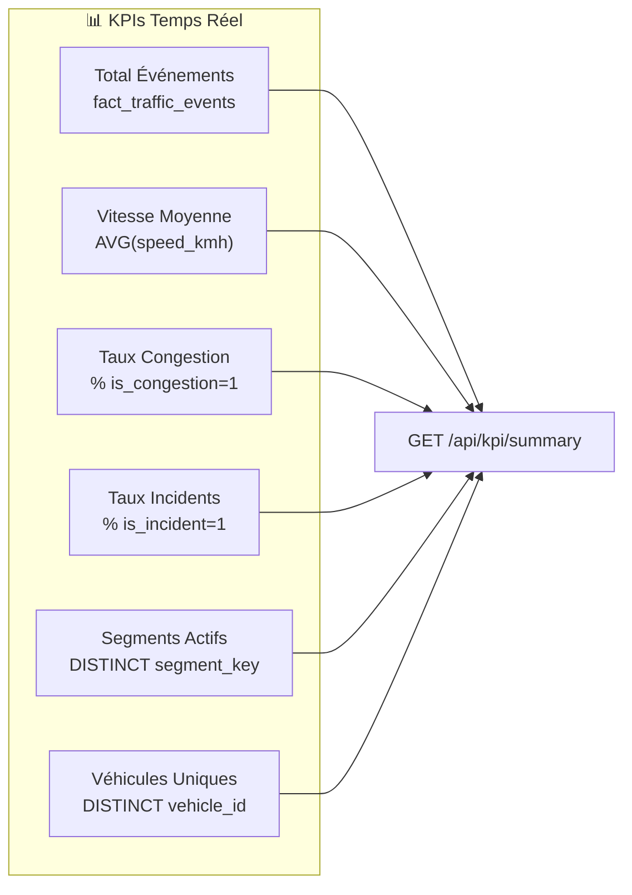
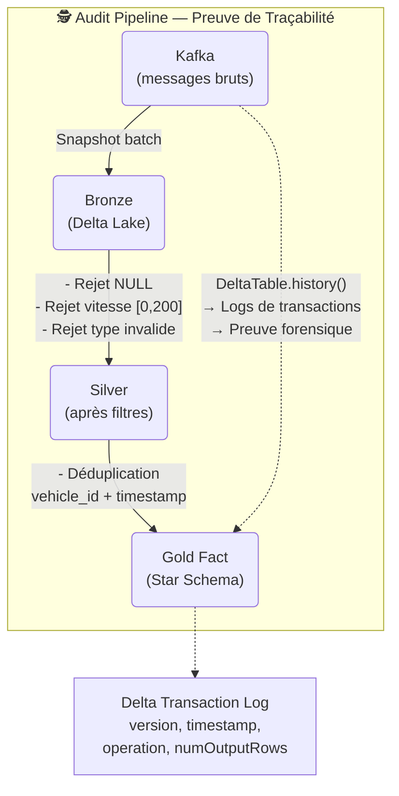
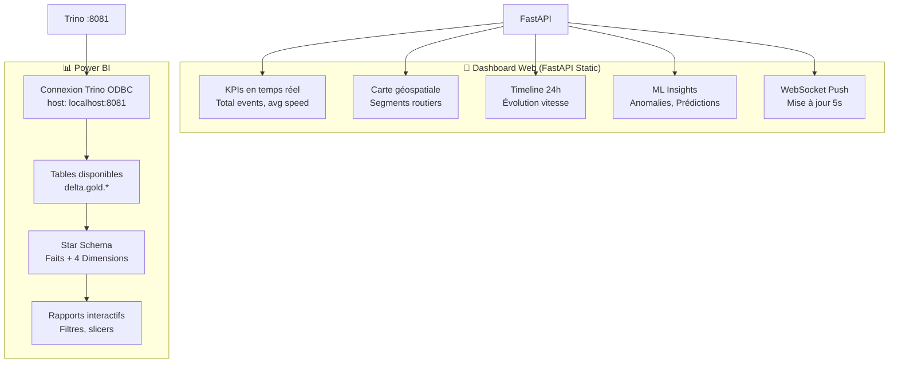
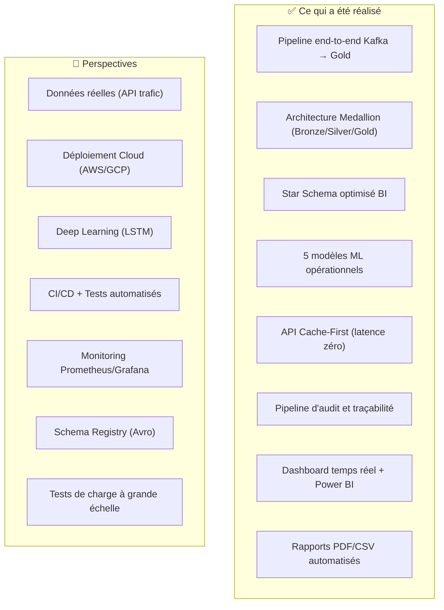

# Présentation Soutenance PFA — Pipeline Trafic Routier Temps Réel

## Structure recommandée (15-20 minutes)

---

## Slide 1 : Page de Garde

```markdown
# PFA — Pipeline Data Engineering
## Analyse du Trafic Routier en Temps Réel
### Ville de Tanger

**Équipe :**
- Youssef MOUHI — Lead Data Engineer
- Malak ARIBI — Spark & Delta Lake
- Ilias COUKRI — Kafka & Infrastructure
- Omaima AMTOT — Hive & Modélisation Gold
- Soufian TAZI CHERTI — Power BI & Visualisation

**Encadrant :** Radouan DAHBI
**EMSI — Data Science / IA — 2025/2026**
```

---

## Slide 2 : Problématique & Objectifs



**Message clé :** Construire un système industriel complet de la donnée à la visualisation.

---

## Slide 3 : Architecture Technique Globale



**Architecture Medallion (Bronze → Silver → Gold)** + **Cache-First API** + **5 modèles ML**.

---

## Slide 4 : Composant 1 — Producteur & Kafka



**Points clés :**
- 8 axes routiers de Tanger modélisés
- 30% de données sales pour tester la résilience
- Simulation des heures de pointe (6-9h, 16-19h)

---

## Slide 5 : Composant 2 — Pipeline Streaming PySpark

```mermaid
graph TB
    subgraph "Bronze"
        B1[readStream Kafka]
        B2[Parse JSON → BRONZE_SCHEMA]
        B3[Métadonnées: ingestion_time, version]
        B1 --> B2 --> B3
    end

    subgraph "Silver"
        S1[Quality Checks<br/>Nulls, Speed [0,200], Type]
        S2[Déduplication<br/>watermark 10s]
        S3[Enrichissement<br/>speed_category, time_of_day,<br/>is_incident, is_congestion]
        S1 --> S2 --> S3
    end

    subgraph "Gold"
        G1[dim_time]
        G2[dim_road_segment]
        G3[dim_event_type]
        G4[dim_vehicle]
        G5[fact_traffic_events]
        G6[ThreadPoolExecutor<br/>5 workers parallèles]
        G1 --> G6
        G2 --> G6
        G3 --> G6
        G4 --> G6
        G5 --> G6
    end

    B3 --> S1
    S3 --> G1
    S3 --> G2
    S3 --> G3
    S3 --> G4
    S3 --> G5
```

**Points clés :**
- **Bronze :** 100% des données brutes préservées
- **Silver :** ~30% filtrées (données sales intentionnelles)
- **Gold :** Star Schema optimisé pour BI

---

## Slide 6 : Composant 3 — Infrastructure Docker



**Points clés :**
- Infrastructure conteneurisée complète (1 commande : `docker-compose up -d`)
- Hive Metastore → Catalogue de tables pour Trino
- Trino → Moteur SQL distribué sur les fichiers Delta

---

## Slide 7 : Composant 4 — API Cache-First



**Message clé :** Zéro requête Trino au clic utilisateur. Cache rafraîchi toutes les 5s.

---

## Slide 8 : Composant 5 — Machine Learning



**Message clé :** Intelligence embarquée avec rafraîchissement automatique.

---

## Slide 9 : Résultats — KPIs & Métriques



**Métriques clés :**
| Métrique | Valeur |
|---|---|
| Débit ingestion | ~1 event/s (scalable) |
| Latence bout en bout | < 5s |
| Taux données sales filtrées | ~30% |
| Temps de refresh cache | 5s (API), 10s (ML) |
| Nombre de modèles ML | 5 |

---

## Slide 10 : Pipeline d'Audit — Traçabilité



**Message clé :** Chaque écart Kafka → Gold est **expliqué et justifié**. Les logs Delta Lake constituent une preuve irréfutable.

---

## Slide 11 : Visualisation — Dashboard & Power BI



---

## Slide 12 : Démonstration en Direct

```bash
# === Étape 1 : Vérifier l'infrastructure ===
docker ps
# Attendu : 6 containers en cours d'exécution

# === Étape 2 : Vérifier Kafka ===
docker exec pfa_kafka kafka-topics \
  --bootstrap-server localhost:9092 --list
# → traffic-events

# === Étape 3 : Compter les messages dans Gold ===
docker exec pfa_trino trino \
  --execute "SELECT COUNT(*) FROM delta.gold.fact_traffic_events"

# === Étape 4 : KPIs agrégés ===
docker exec pfa_trino trino \
  --execute "SELECT COUNT(*) AS total_events,
    ROUND(AVG(speed_kmh), 1) AS avg_speed,
    ROUND(AVG(is_congestion)*100, 1) AS congestion_pct
  FROM delta.gold.fact_traffic_events"

# === Étape 5 : Vérifier l'API ===
curl http://localhost:8000/api/kpi/summary

# === Étape 6 : Ouvrir le dashboard ===
start http://localhost:8000
```

---

## Slide 13 : Bilan & Perspectives



---

## Slide 14 : Compétences Acquises

| Domaine | Compétences |
|---|---|
| **Data Engineering** | Kafka, PySpark, Delta Lake, Hive, Trino |
| **Streaming** | Structured Streaming, watermark, déduplication |
| **Architecture** | Medallion, Star Schema, Cache-First |
| **DevOps** | Docker, Docker Compose |
| **API** | FastAPI, WebSocket, REST |
| **Machine Learning** | RandomForest, Isolation Forest, Linear Regression |
| **BI** | Power BI, Trino ODBC |
| **Qualité** | Data Quality, Audit, Traçabilité |

---

## Slide 15 : Questions / Remerciements

```markdown
# Merci pour votre attention !

## Questions ?

### Liens utiles
- **GitHub :** https://github.com/...
- **Dépôt du projet :** ...

### Démonstration en direct
```

---

## Conseils pour la Soutenance

| Minute | Slide | Action |
|---|---|---|
| 0-2 | 1-2 | Introduction, contexte, problématique |
| 2-5 | 3 | Architecture globale (vue d'ensemble) |
| 5-8 | 4-5 | Pipeline détaillé (Producer → Gold) |
| 8-10 | 6 | Infrastructure Docker |
| 10-12 | 7-8 | API + ML |
| 12-14 | 9-10 | Résultats + Audit |
| 14-15 | 11 | Visualisation |
| 15-17 | 12 | Démo en direct |
| 17-18 | 13-14 | Bilan, perspectives, compétences |
| 18-20 | 15 | Questions |
